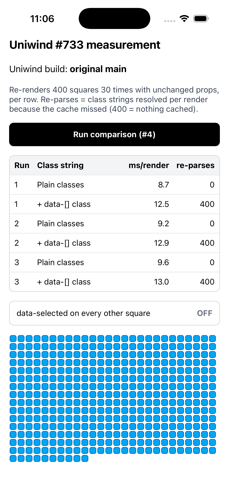
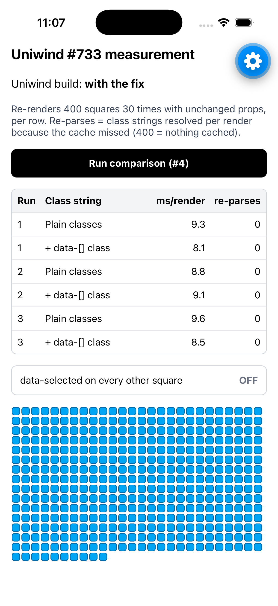
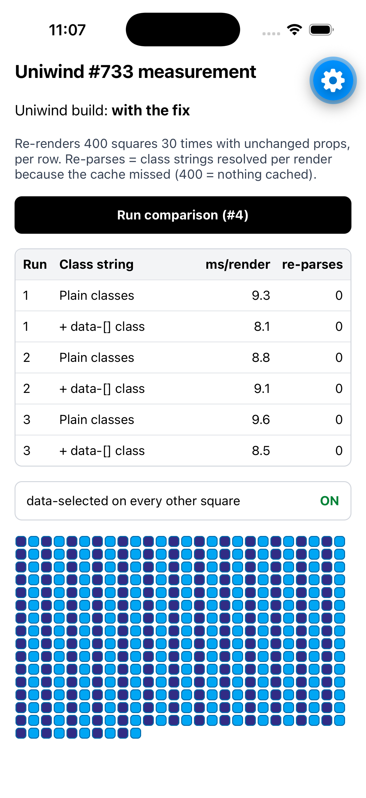

# Measuring uniwind#733: caching `data-[…]` styles on native

This app measures [uni-stack/uniwind#733](https://github.com/uni-stack/uniwind/issues/733). Uniwind never caches a class string that contains a `data-[…]` variant, so it re-parses that string on every render. The app runs two real Uniwind builds side by side: the original `main` and a build with the fix.

## Credit

This is based on **[@harveyappleton](https://github.com/harveyappleton)**'s repro, [harveyappleton/uniwind-data-attr-repro](https://github.com/harveyappleton/uniwind-data-attr-repro). Harvey found the issue, profiled it in a real app, and built the 400-square benchmark this app reuses: the same grid, class strings and render-timing method.

The one change: Harvey's app switches between stock and fixed behaviour by patching Uniwind at runtime. This app removes that toggle and instead runs on two **real Uniwind packages** built with `npm pack`, so it measures the actual change.

## Results

iPhone 17 simulator (iOS 26.5), Expo Go SDK 58, production JS (`--no-dev --minify`), Apple Silicon Mac, 2026-11-05. Each run re-renders 400 squares 30 times with unchanged props.

| Build | Class string | ms/render (3 runs) | avg | re-parses/render |
| --- | --- | --- | --- | --- |
| original `main` | plain | 8.7 / 9.2 / 9.6 | 9.2 | 0 |
| original `main` | + `data-[]` | 12.5 / 12.9 / 13.0 | **12.8** | **400** |
| with the fix | plain | 9.3 / 8.8 / 9.6 | 9.2 | 0 |
| with the fix | + `data-[]` | 8.1 / 9.1 / 8.5 | **8.6** | **0** |

"Re-parses" counts the class strings Uniwind had to resolve per render because its cache missed. 400 means none of the 400 squares were cached.

With the fix, the `data-[]` grid renders as fast as plain classes and is never re-parsed. Styles still switch correctly: with `data-selected` on, every other square turns dark, and they all go back when it's off.

| Original `main` | With the fix | Fix, `data-selected` on |
| --- | --- | --- |
|  |  |  |

A simulator on a fast Mac understates the difference. Harvey notes the gap is much bigger on low-end Android devices.

## Run it yourself

Needs Node 20+, and Xcode with an iOS simulator (or an Android emulator).

```bash
git clone https://github.com/JaydeepAgravat/uniwind-733-measure.git
cd uniwind-733-measure
npm install
```

**Original build:**
```bash
npm run use:main && npm run ios
```
Tap **Run comparison** a few times. The screen shows `Uniwind build: original main`.

**Build with the fix:**
```bash
npm run use:fix && npm run ios
```
The screen now shows `Uniwind build: with the fix`.

If the simulator doesn't open on its own, run `npm run start` and press `i`. `npm run start` also works if you'd rather open the app in Expo Go on a phone. Metro prints a "not listed in exports" warning for `uniwind/src/core/native/store`. That's expected: the re-parse counter hooks into Uniwind's internal store.

## What's in here

| Path | What it is |
| --- | --- |
| `builds/uniwind-main.tgz` | Uniwind 1.13.1 built from `uni-stack/uniwind` `main` @ `346d4e0` |
| `builds/uniwind-fix.tgz` | The same commit plus the #733 fix |
| `resolveCounter.ts` | Counts `resolveStyles` calls (cache misses) and detects which build is loaded |
| `App.tsx` | Harvey's benchmark, minus the runtime fix toggle, plus a table of repeated runs |
| `screenshots/` | The runs in the table above |

SHA-256 of the builds:
```
767c8e972d51a6cd2b23627d8790dc35d320e20d8488644bf22a6350eb1bbd2f  builds/uniwind-main.tgz
7a1fbbcb7289a31349dfdeec01689ae27d72b25cfa70a5024453e7118a57bf83  builds/uniwind-fix.tgz
```

## The fix in short

Each style rule now carries the names of the `data-*` attributes it reads. For each class string, Uniwind collects those names once. It then adds those props' values to the cache key, normalized the way the generated match functions compare them: `true` and `"true"` count as the same, and number `1` and string `"1"` stay different. Then it caches the result like any other style. Details are in the PR for #733.

## License

MIT, see [LICENSE](LICENSE) (inherited from the Expo template Harvey's repro is based on). The Uniwind builds in `builds/` are MIT licensed by Uniwind; the license ships inside each package.
